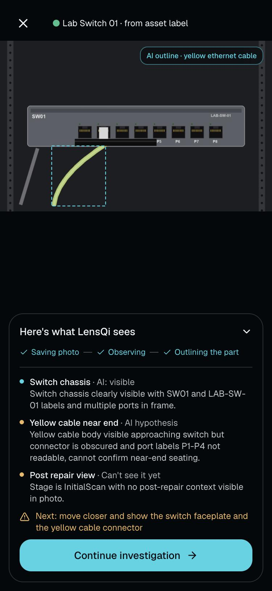
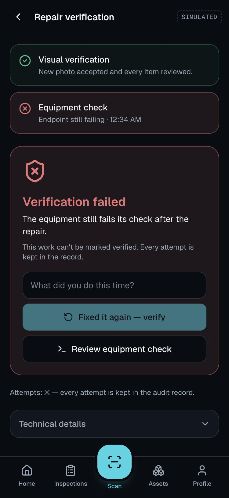
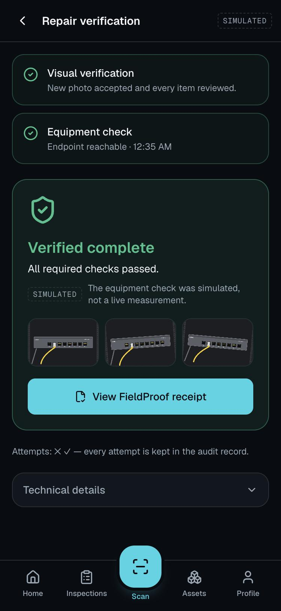

# LensQi FieldOps

**See the task. Do it right. Prove it when it matters.** Meta Global AI Developer Hackathon 2026, Indie track, Push the Frontier.

## Built for the Meta Global AI Developer Hackathon

Event-period implementation includes guided tasks on web and Android, “Just ask” camera help, the FieldProof
inspection workflow, approved diagnostics, receipts and the operations dashboard. Muse Spark 1.3
(`muse-spark-1.3`) serves plans, coaching, step checks and inspection assessment; SAM 3.1 (`sam-3.1`) serves
segmentation. Muse Spark Open is **not integrated**: the requested hackathon alias and credentials remain unconfirmed
([feasibility record](docs/evidence/tasks/open-model-feasibility.md)).

The v1.1/v2.0 specification kits and pre-event design material are not claimed as new implemented functionality.
No private LensIQ source is copied. The [contribution ledger](docs/HACKATHON_CONTRIBUTIONS.md) separates
implementation from baseline/design material and records remaining attribution questions.

From a clean checkout of this branch, `dotnet test --nologo` exercises the API with fake models and simulated probes,
including `TechnicianJourneyTests`. `scripts/clean_room_check.sh --source . --no-meta` clones committed work and
checks the inspection demo and receipts without paid model calls; it does not provide a fake-model interactive
planner. Genuine calls are skipped explicitly. Neither command uses Docker. See [journey evidence and reproduction](docs/evidence/tasks/technician-journey.md).

## What this is

LensQi walks a person through a hands-on technical job with a live camera, AR outlines, AI-written steps and voice. It
has two modes built on one guided-task core:

- **DIY mode** for everyday technical users: "change the oil in my 2025 Civic", "mount an IP camera". The user states a
  goal, Muse Spark writes a plan labelled "AI-written plan · check your owner's manual" with a risk level, per-step
  cautions and stop-if conditions, and the live camera and voice guide each step. SAM 3.1 outlines the parts a step needs;
  ARCore adds anchors and measured distance on supported Android phones, with 2D tracking elsewhere. Spoken guidance,
  push-to-talk or opt-in hands-free questions and voice commands send only recognised text to LensQi. Android uses `SpeechRecognizer`,
  preferring the on-device recognizer where available on Android 12+; its system fallback may use a provider service.
  Web uses the Web Speech API, which in some browsers sends audio to the browser vendor. The web UI discloses this
  and offers typing instead. An
  optional step photo check suggests whether a step looks done; the user decides.
- **Technician mode** for installs, repairs and on-site help, with the same guided steps. A task tied to a site record
  finishes with the approved equipment check and a FieldProof verified receipt.
- **Free-form help ("Just ask")** for spontaneous use: the camera opens at once and the user asks about whatever is in
  view by voice or text, with no plan first. "Make a plan" turns a longer job into a guided task.

For recognized restricted categories (gas, mains electrical, EV high voltage, airbags, refrigerant and structural work),
`TaskPlanValidator` structurally rejects plans containing hands-on steps or missing the required professional referral.
Free-form answers use prompt instructions, output checks and a referral safeguard: the server appends a referral when
a question matches the configured restricted phrases and the answer lacks “professional”. This weaker mechanism does
not block every unsafe answer. Only FieldProof marks anything verified.

**Status (October 29, 2026):** guided tasks, free-form help and the technician hand-off to FieldProof are built on
the `guided-tasks` branch for web and Android. On October 29 the suites passed: 220 .NET tests, 25 web tests and 107
Android unit tests. Genuine plans, typed questions, step checks and live step coaching are recorded in
[docs/evidence/tasks/](docs/evidence/tasks/) from the browser and the emulator. A technician task linked to an
inspection reaches `VerifiedCompleteSimulated` and an offline-verified receipt in an API journey test with fake models
([technician-journey.md](docs/evidence/tasks/technician-journey.md)). Not yet: a phone run of the task flow, voice with
a real microphone, ARCore anchors or distance on a real part (the first S23 Ultra ARCore run produced none,
[docs/LIVE_AR.md](docs/LIVE_AR.md)), spoken-feedback gating on the Android step runner, the
offline queue for step-check photos, and glasses on tasks. Plan and status per task: [PRD.md](PRD.md) §1,
[.kiro/specs/guided-tasks/tasks.md](.kiro/specs/guided-tasks/tasks.md).

### The FieldProof inspection loop (Technician mode, built)

1. A field technician photographs equipment. Muse Spark 1.3 says what it observes, suspects or cannot see, and asks for a better view instead of guessing.
2. SAM 3.1 localizes the cited part (the yellow cable) on the original pixels; the crop is never treated as independent evidence.
3. A read-only diagnostic, chosen only from the fixture's allowlist and resolved server-side, measures the endpoint. Every result is labelled LIVE, SIMULATED or REPLAY.
4. Vendor and site documentation guides the investigation with cited facts; it is never evidence that a repair worked.
5. When the technician claims a repair, change evidence compares the new photo with the earlier ones: a re-submitted or unchanged photo is rejected before any probe runs.
6. Code, not the model, owns every state transition. A repair is **Verified Complete** only when a fresh accepted post-repair photo, a human-reviewed checklist, an acknowledgement and a fresh passing diagnostic all agree.
7. A simulated or replayed measurement can never produce `VerifiedCompleteLive`.
8. Every inspection issues a FieldProof receipt: canonical JSON, a digest per artifact, an append-only event trail, and an offline verifier that fails on a one-byte change.
9. Surfaces: a technician web app and an operations dashboard (React, built into the API, no Node at runtime), and an Android client (Kotlin/Compose) that works offline and syncs a hashed capture when the network returns.
10. Everything here was written during the event; no private LensIQ source is copied.

| | | |
|---|---|---|
|  |  |  |

## Measured, not claimed

Latest evaluation, `docs/evaluation/eval-20261028T061752Z.md`: 25 labelled scenarios (4 held out) over synthetic renders,
genuine `muse-spark-1.3` and `sam-3.1` calls, simulated endpoint.

| Metric | Result |
|---|---:|
| Deterministic expectations | 25 / 25 |
| False completions with the full loop and gate | **0** |
| Fake fixes a single model look would have accepted | 4 / 5 |
| Change evidence on post-repair photos: duplicate / no change / changed / unscorable | 2 / 1 / 6 / 2 |
| Probes run on a rejected post-repair photo | 0 |
| Receipts verified / issued | 12 / 12 |

Live code path: `docs/evidence/receipt-loopback/` is a genuine `LiveLocal` HTTP measurement of a loopback server standing
in for the lab endpoint (`VerifiedCompleteLive`, labelled `LIVE_LOCAL_PROBE (loopback)`); the owned-hardware run is
`docs/LIVE_PROBE_RUNBOOK.md`. Every evidence file and its label: [docs/evidence/README.md](docs/evidence/README.md).

## Reproduce

Prerequisites: .NET 10 SDK, Python 3.10+, and for genuine model calls a Meta Model API key in `.env`
(`cp .env.example .env`, then set `MODEL_API_KEY`; the key is read only from server configuration or the environment).

One command checks everything from a fresh clone (validators, tests, the hero flow over HTTP, receipts, two genuine-call
scenarios) and prints `RESULT: PASS` or `FAIL`:

```bash
scripts/clean_room_check.sh
```

Step by step:

```bash
python3 -m venv .venv && .venv/bin/pip install -r scripts/requirements.txt -r tools/sam-parser/requirements.txt
```

```bash
dotnet test --nologo
```

```bash
dotnet run --project src/LensQi.FieldOps.Api --no-launch-profile --urls http://127.0.0.1:5199
```

Open <http://127.0.0.1:5199/m> for the technician app (a phone frame on a desktop, full screen on a phone) and
<http://127.0.0.1:5199/ops> for the operations dashboard. Demo controls for the simulated endpoint appear only in
Simulated mode (the default). The API refuses to start if any knowledge pack, fixture binding or expected twin is invalid.

The web app's source is `apps/web` (React, Tailwind, TanStack Query); its built bundle is committed in the API's
`wwwroot`, so running the API needs no Node. To change the UI:

```bash
cd apps/web && npm ci && npm run dev
```

`npm run dev` serves on port 5173 and proxies the API on 5199; `npm run build` typechecks and rewrites `wwwroot`. The
clean-room check fails if the committed bundle differs from a fresh build.

```bash
dotnet run --project tools/LensQi.FieldOps.Eval -- --base http://127.0.0.1:5199 --only c01-clear-p2,f01-seated-down
```

```bash
dotnet run --project tools/LensQi.FieldOps.VerifyReceipt -- docs/evidence/receipt-sample
```

Android (JDK 21 and the Android SDK; the emulator reaches the host at `10.0.2.2:5199`):

```bash
cd apps/android && ./gradlew :app:testDebugUnitTest :app:assembleDebug
```

## How it works

| Piece | Where |
|---|---|
| Guided-task session, append-only events, plan validator with restricted categories | `src/LensQi.FieldOps.Core/Tasks/` |
| Task planner and step coach (guidance, questions, step checks) on Muse Spark | `src/LensQi.FieldOps.Meta/Tasks/` |
| `/v1/tasks` API and its JSONL task store | `src/LensQi.FieldOps.Api/Features/Tasks/`, `Api/Infrastructure/Tasks/` |
| Task screens: web `apps/web/src/pages/m/task/`, `lib/tasks.ts`, `lib/voice.ts`; Android `ui/task/`, `voice/Voice.kt` | `apps/web/`, `apps/android/` |
| Inspection state machine, append-only events, dual-proof policy (`fieldproof-policy/1.5`) | `src/LensQi.FieldOps.Core/Inspection/` |
| Change evidence: dHash duplicates, SAM mask IoU and shift, versioned thresholds | `Core/Inspection/VisualChange.cs`, `Api/Infrastructure/Evidence/ChangeEvidenceService.cs` |
| Muse Spark client (strict JSON schema), visual assessment, grounded proposals | `src/LensQi.FieldOps.Meta/Muse`, `Vision`, `Knowledge` |
| SAM 3.1 client (Responses API) and the Python sidecar (parser, crop, image measurements) | `src/LensQi.FieldOps.Meta/Segmentation`, `tools/sam-parser/` |
| Probes: simulated, recorded replay, guarded live HTTP; server-side alias resolution | `src/LensQi.FieldOps.Diagnostics/` |
| Minimal API, hardening (timeouts, rate limits, image limits) | `src/LensQi.FieldOps.Api/` |
| Technician web app and operations dashboard (plain-language states, technical details collapsed) | `apps/web/` → `src/LensQi.FieldOps.Api/wwwroot/` |
| FieldProof receipts and the offline verifier | `src/LensQi.FieldOps.Core/Receipts/`, `tools/LensQi.FieldOps.VerifyReceipt/` |
| Android client: CameraX capture, Room queue, WorkManager sync, cached views | `apps/android/` |
| Expected twin, vendor knowledge packs, evaluation scenarios, API recordings | `fixtures/` |

The hero flow over HTTP, endpoint by endpoint, is in `.claude/skills/fieldops-run-and-verify/SKILL.md` and runs end to end
in `scripts/clean_room_check.sh`; every response the Android client codes against is recorded in `fixtures/api-recordings/`
(`fixtures/api-recordings/index.json` lists method and path) by `scripts/record_api.py`.

## Read next

| Document | Purpose |
|---|---|
| [docs/DEMO_STORYBOARD.md](docs/DEMO_STORYBOARD.md) | The three-minute video, shot by shot, with what is simulated and what is live |
| [docs/evidence/README.md](docs/evidence/README.md) | Every recorded artifact and its label |
| [docs/LIVE_PROBE_RUNBOOK.md](docs/LIVE_PROBE_RUNBOOK.md) | Live probe against an owned endpoint |
| [PRD.md](PRD.md) | Product requirements: scope, state machine, trust invariants |
| [.kiro/specs/](.kiro/specs/) | Guided-tasks spec, the FieldProof parent spec and the vendor-knowledge child spec, with task status |
| [docs/evidence/tasks/README.md](docs/evidence/tasks/README.md) | Guided-task recordings: genuine plans, questions, checks, emulator screenshots, the technician journey |
| [docs/PITCH.md](docs/PITCH.md) | Product pitch and feature review |
| [docs/PRODUCTION_DESIGN.md](docs/PRODUCTION_DESIGN.md) | Beyond the demo: architecture and roadmap |
| [docs/HACKATHON_CONTRIBUTIONS.md](docs/HACKATHON_CONTRIBUTIONS.md) | Event-period work ledger, one row per commit |
| [docs/PRIOR_ART.md](docs/PRIOR_ART.md) | Provenance and third-party inputs |
| [docs/OPUS_HANDOFF_PLAN.md](docs/OPUS_HANDOFF_PLAN.md) | The parallel plan to the November 4 submission |

## Limits, stated plainly

- HTTP 200 from an endpoint is a measured fact about that endpoint at that moment, not proof of correct cabling; the
  lab switch is unmanaged and no probe here can see which port is used.
- Model output, documentation citations and predictions are not evidence that equipment was repaired.
- A `Changed` change-evidence verdict means something in the target region changed; lighting or angle can cause it.
  It is necessary for a repair claim, never sufficient.
- A receipt detects tampering within its bundle; it cannot prove who captured the original image.
- The images in this repository are synthetic renders. No real-equipment photographs or lab-hardware measurements are
  included yet. The Android inspection and guided-task flows have run on the emulator; the only physical-phone run so far
  is the S23 Ultra ARCore live-assist check in `docs/LIVE_AR.md`, which produced no anchor or distance.
- Task plans are AI-written guidance, not manufacturer instructions or safety certification. A step photo check is a
  suggestion; a task's `Completed` phase is not verification.
- Free-form answers about restricted work rely on a phrase match and an appended referral, not structural rejection.
- Task command idempotency keys are held in memory: after an API restart a retried task command is checked against
  state again rather than replayed. Inspection verify decisions are persisted by request id.

## Provenance

New public repository created during the event. No source from the private `Telli/LensIQ-Monorepo` is copied
(PRD §4A, `docs/SOURCES_AND_RIGHTS.md`, `docs/COMPONENT_REUSE.md`). Licensed under AGPL-3.0-only.
