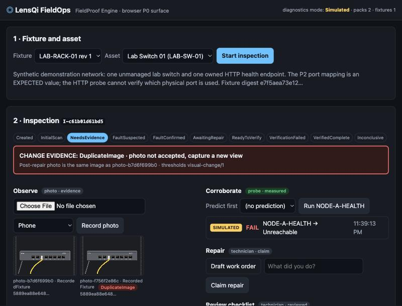

# LensQi FieldOps

**See the problem. Prove the solution.** Meta Global AI Developer Hackathon 2026, Indie track, Push the Frontier.

## What this is

1. A field technician photographs equipment. Muse Spark 1.3 says what it observes, suspects or cannot see, and asks for a better view instead of guessing.
2. SAM 3.1 localizes the cited part (the yellow cable) on the original pixels; the crop is never treated as independent evidence.
3. A read-only diagnostic, chosen only from the fixture's allowlist and resolved server-side, measures the endpoint. Every result is labelled LIVE, SIMULATED or REPLAY.
4. Vendor and site documentation guides the investigation with cited facts; it is never evidence that a repair worked.
5. When the technician claims a repair, change evidence compares the new photo with the earlier ones: a re-submitted or unchanged photo is rejected before any probe runs.
6. Code, not the model, owns every state transition. A repair is **Verified Complete** only when a fresh accepted post-repair photo, a human-reviewed checklist, an acknowledgement and a fresh passing diagnostic all agree.
7. A simulated or replayed measurement can never produce `VerifiedCompleteLive`.
8. Every inspection issues a FieldProof receipt: canonical JSON, a digest per artifact, an append-only event trail, and an offline verifier that fails on a one-byte change.
9. Surfaces: a browser UI (the guaranteed P0) and an Android client (Kotlin/Compose) that works offline and syncs a hashed capture when the network returns.
10. Everything here was written during the event; no private LensIQ source is copied.



## Measured, not claimed

Latest evaluation, `docs/evaluation/eval-20261028T061752Z.md`: 25 labelled scenarios (4 held out) over synthetic renders,
genuine `muse-spark-1.3` and `sam-3.1` calls, simulated endpoint.

| Metric | Result |
|---|---:|
| Deterministic expectations | 25 / 25 |
| False completions with the full loop and gate | **0** |
| Fake fixes a single model look would have accepted | 4 / 5 |
| Change evidence on post-repair photos: duplicate / no change / changed / unscorable | 2 / 1 / 6 / 2 |
| Probes run on a rejected post-repair photo | 0 |
| Receipts verified / issued | 12 / 12 |

Live code path: `docs/evidence/receipt-loopback/` is a genuine `LiveLocal` HTTP measurement of a loopback server standing
in for the lab endpoint (`VerifiedCompleteLive`, labelled `LIVE_LOCAL_PROBE (loopback)`); the owned-hardware run is
`docs/LIVE_PROBE_RUNBOOK.md`. Every evidence file and its label: [docs/evidence/README.md](docs/evidence/README.md).

## Reproduce

Prerequisites: .NET 10 SDK, Python 3.10+, and for genuine model calls a Meta Model API key in `.env`
(`cp .env.example .env`, then set `MODEL_API_KEY`; the key is read only from server configuration or the environment).

One command checks everything from a fresh clone (validators, tests, the hero flow over HTTP, receipts, two genuine-call
scenarios) and prints `RESULT: PASS` or `FAIL`:

```bash
scripts/clean_room_check.sh
```

Step by step:

```bash
python3 -m venv .venv && .venv/bin/pip install -r scripts/requirements.txt -r tools/sam-parser/requirements.txt
```

```bash
dotnet test --nologo
```

```bash
dotnet run --project src/LensQi.FieldOps.Api --no-launch-profile --urls http://127.0.0.1:5199
```

Open <http://127.0.0.1:5199/> for the browser UI. The demo controls for the simulated endpoint appear only in Simulated
mode (the default). The API refuses to start if any knowledge pack, fixture binding or expected twin is invalid.

```bash
dotnet run --project tools/LensQi.FieldOps.Eval -- --base http://127.0.0.1:5199 --only c01-clear-p2,f01-seated-down
```

```bash
dotnet run --project tools/LensQi.FieldOps.VerifyReceipt -- docs/evidence/receipt-sample
```

Android (JDK 21 and the Android SDK; the emulator reaches the host at `10.0.2.2:5199`):

```bash
cd apps/android && ./gradlew :app:testDebugUnitTest :app:assembleDebug
```

## How it works

| Piece | Where |
|---|---|
| Inspection state machine, append-only events, dual-proof policy (`fieldproof-policy/1.2`) | `src/LensQi.FieldOps.Core/Inspection/` |
| Change evidence: dHash duplicates, SAM mask IoU and shift, versioned thresholds | `Core/Inspection/VisualChange.cs`, `Api/Infrastructure/Evidence/ChangeEvidenceService.cs` |
| Muse Spark client (strict JSON schema), visual assessment, grounded proposals | `src/LensQi.FieldOps.Meta/Muse`, `Vision`, `Knowledge` |
| SAM 3.1 client (Responses API) and the Python sidecar (parser, crop, image measurements) | `src/LensQi.FieldOps.Meta/Segmentation`, `tools/sam-parser/` |
| Probes: simulated, recorded replay, guarded live HTTP; server-side alias resolution | `src/LensQi.FieldOps.Diagnostics/` |
| Minimal API, hardening (timeouts, rate limits, image limits), browser UI | `src/LensQi.FieldOps.Api/` |
| FieldProof receipts and the offline verifier | `src/LensQi.FieldOps.Core/Receipts/`, `tools/LensQi.FieldOps.VerifyReceipt/` |
| Android client: CameraX capture, Room queue, WorkManager sync, cached views | `apps/android/` |
| Expected twin, vendor knowledge packs, evaluation scenarios, API recordings | `fixtures/` |

The hero flow over HTTP, endpoint by endpoint, is in `.claude/skills/fieldops-run-and-verify/SKILL.md` and runs end to end
in `scripts/clean_room_check.sh`; every response the Android client codes against is recorded in `fixtures/api-recordings/`
(`fixtures/api-recordings/index.json` lists method and path) by `scripts/record_api.py`.

## Read next

| Document | Purpose |
|---|---|
| [docs/DEMO_STORYBOARD.md](docs/DEMO_STORYBOARD.md) | The three-minute video, shot by shot, with what is simulated and what is live |
| [docs/evidence/README.md](docs/evidence/README.md) | Every recorded artifact and its label |
| [docs/LIVE_PROBE_RUNBOOK.md](docs/LIVE_PROBE_RUNBOOK.md) | Live probe against an owned endpoint |
| [PRD.md](PRD.md) | Product requirements: scope, state machine, trust invariants |
| [.kiro/specs/](.kiro/specs/) | Parent spec and the vendor-knowledge child spec, with task status |
| [docs/PRODUCTION_DESIGN.md](docs/PRODUCTION_DESIGN.md) | Beyond the demo: architecture and roadmap |
| [docs/HACKATHON_CONTRIBUTIONS.md](docs/HACKATHON_CONTRIBUTIONS.md) | Event-period work ledger, one row per commit |
| [docs/PRIOR_ART.md](docs/PRIOR_ART.md) | Provenance and third-party inputs |
| [docs/OPUS_HANDOFF_PLAN.md](docs/OPUS_HANDOFF_PLAN.md) | The parallel plan to the November 4 submission |

## Limits, stated plainly

- HTTP 200 from an endpoint is a measured fact about that endpoint at that moment, not proof of correct cabling; the
  lab switch is unmanaged and no probe here can see which port is used.
- Model output, documentation citations and predictions are not evidence that equipment was repaired.
- A `Changed` change-evidence verdict means something in the target region changed; lighting or angle can cause it.
  It is necessary for a repair claim, never sufficient.
- A receipt detects tampering within its bundle; it cannot prove who captured the original image.
- The images in this repository are synthetic renders. No real-equipment photographs or lab-hardware measurements are
  included yet, and the Android client has run on the emulator, not on a physical phone.

## Provenance

New public repository created during the event. No source from the private `Telli/LensIQ-Monorepo` is copied
(PRD §4A, `docs/SOURCES_AND_RIGHTS.md`, `docs/COMPONENT_REUSE.md`). Licensed under AGPL-3.0-only.
