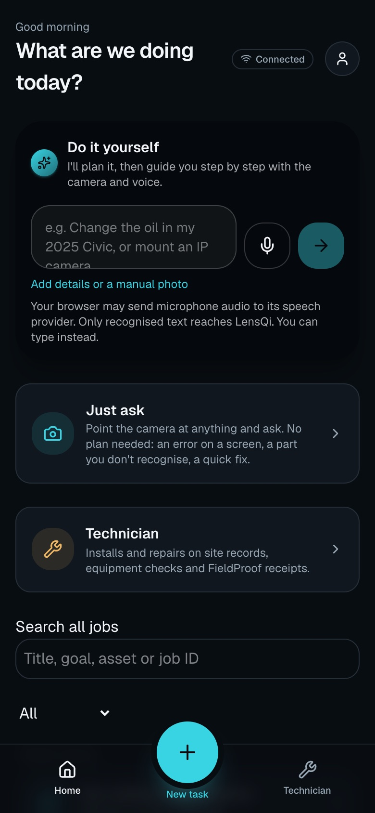
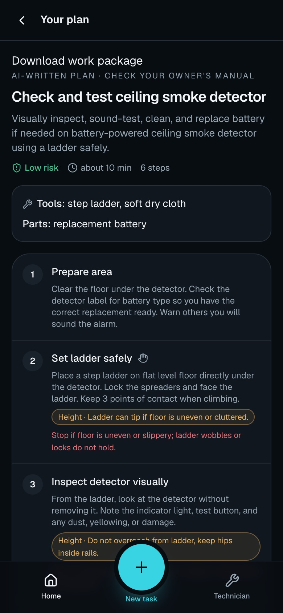
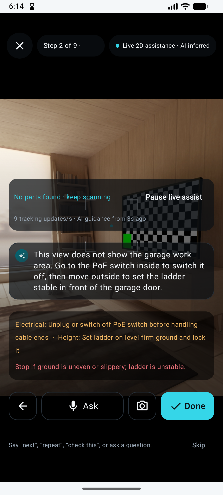
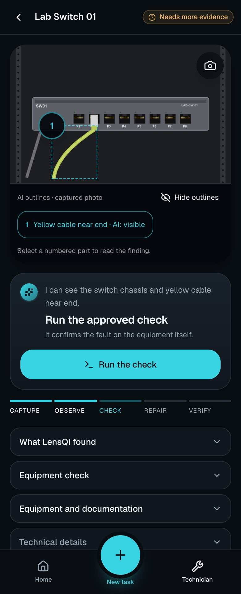
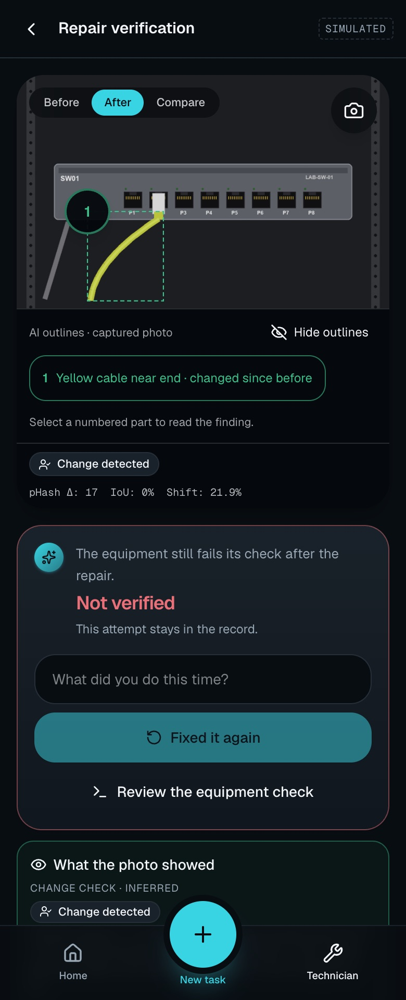
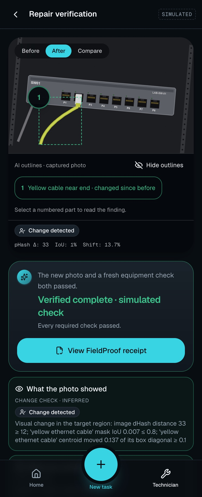
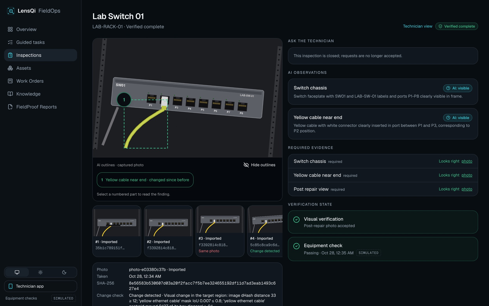

# LensQi FieldOps

**Visual guidance for technical work. A clear record of what was done and checked.**

LensQi FieldOps guides technicians and DIY users through hands-on technical jobs with camera assistance, step-by-step
plans, voice questions and cited references. Browser and Android clients support the work on site, and an operations
dashboard brings inspections, evidence and outcomes into one place.

For repairs tied to a site record, **FieldProof** adds a verification workflow: capture the evidence, review the work,
run an approved equipment check and issue a receipt. AI supports the investigation; a deterministic policy makes the
verification decision. Completing a guided task and verifying a repair are separate outcomes.

> [!IMPORTANT]
> This is a development and demonstration application. It has no authentication or tenant isolation, so run it only in
> a local or controlled environment. See [Scope and limits](#scope-and-limits).

[Screens](#screens) · [Features](#what-you-can-do) · [Quick start](#quick-start) ·
[Verification](#how-fieldproof-verifies-a-repair) · [Development](#development-and-testing) ·
[Architecture](#architecture) · [Evidence](#validation-and-evidence) · [Docs](#documentation)

## Screens

**Guided work:** describe the job, review the plan, then work through it with the camera.

| Choose how to work | Review the AI-written plan | Follow the step · Android emulator |
|---|---|---|
|  |  |  |

**FieldProof:** a plausible photo is not enough. The repair must also pass the approved equipment check.

| Investigate | Refused: the check still fails | Passed · simulated |
|---|---|---|
|  |  |  |

**Operations dashboard:** each photo with its origin and digest, AI observations, required evidence and check results.



*The web screens replay recorded inspections and use synthetic equipment images and simulated diagnostics. The Android
step is an earlier capture from the emulator's virtual room, not a physical phone. The
[evidence index](docs/evidence/README.md#readme-screens-ui-v3) gives the origin and scope of each image.*

## What you can do

- **Just ask.** Ask about the camera view by voice or text, then carry selected photos and answers into a guided plan.
- **Guided work.** Create a plan with tools, reference photos, risk levels, cautions and stop conditions. Follow live
  guidance, ask about visible parts and request photo checks. You decide when a step is complete.
- **Verified inspections.** Investigate an asset, consult applicable vendor facts, record a repair claim, review
  post-repair evidence and run the fixture's approved diagnostic. The decision is shown with its reasons.
- **Work without signal.** Reopen saved jobs and reference pages, queue supported captures and step updates, and
  synchronize when connectivity returns. Android can also download a site pack with asset knowledge and open
  inspections. Model calls and verification require the server.
- **Review and handover.** Review tasks, assets, knowledge packs and reports in the web dashboard. Export work packages
  with photos, origins, digests and any already-issued linked receipt.
- **Teaching recordings.** Record demonstrations on Android with timed action annotations, consent controls, human
  review and a validated export.

| Client | Capture and guidance |
|---|---|
| **Both** | Spoken guidance, optional hands-free questions and typed questions |
| **Web** | Browser camera and speech capabilities |
| **Android** | CameraX capture, on-device asset label recognition, ARCore on compatible phones, an optional Meta glasses integration and repair claims recorded with Muse Voice |

## Quick start

The API serves the committed web bundle and stores data in local JSONL event logs and evidence files. You don't need
Node.js, a database server or Docker to run the application.

### Prerequisites

| To do this | You need |
|---|---|
| Run the API and image processing | .NET 10 SDK, Python with `venv` and `pip`, and Git |
| Use AI features | A Meta Model API key with access to `muse-spark-1.3` and `sam-3.1`, plus `muse-voice-transcribe-1.0` for speech input |
| Develop the web app, or run the full reproducibility check | Node.js 22.12+ on the 22.x line, or Node.js 24, with npm |
| Develop the Android app | JDK 21 and Android SDK platform 35. The app supports Android 12 (API 31) and later |

Commands use a macOS or Linux shell and start in the repository root unless noted.

### Run the API and web app

1. Clone the repository and install the Python dependencies:

   ```bash
   git clone https://github.com/Telli/lensqi-fieldops.git
   cd lensqi-fieldops
   python3 -m venv .venv
   .venv/bin/python -m pip install -r scripts/requirements.txt -r tools/sam-parser/requirements.txt
   ```

2. Create your configuration file, then set `MODEL_API_KEY` in `.env`:

   ```bash
   cp .env.example .env
   ```

3. Start the API:

   ```bash
   dotnet run --project src/LensQi.FieldOps.Api --no-launch-profile --urls http://127.0.0.1:5199
   ```

4. Open the app:

   | Address | Purpose |
   |---|---|
   | [127.0.0.1:5199/m](http://127.0.0.1:5199/m) | Guided tasks and technician inspections |
   | [127.0.0.1:5199/ops](http://127.0.0.1:5199/ops) | Operations dashboard |
   | [127.0.0.1:5199/health](http://127.0.0.1:5199/health) | API health, loaded fixtures and diagnostic mode |

**Without a model key,** the server and deterministic inspection checks still run. Planning, visual assessment,
segmentation and coaching require genuine model access; there is no interactive fake-model planner.

<details>
<summary>Configuration notes</summary>

- The API reads the key from server configuration, the environment or the gitignored `.env` file.
- It detects the Python virtual environment automatically. Set `FIELDOPS_PYTHON` to use another interpreter.
- Invalid knowledge packs, bindings or site records prevent startup.
- Simulated diagnostic controls appear only when `Diagnostics:Mode` is `Simulated`.
- Data is stored in `src/LensQi.FieldOps.Api/data/` by default. Override it with `Storage__DataDirectory`.
- Other defaults live in [appsettings.json](src/LensQi.FieldOps.Api/appsettings.json).

</details>

### Reproduce the inspection demo without model calls

```bash
scripts/clean_room_check.sh --source . --no-meta
```

This clones the current committed branch into a temporary directory, installs Python dependencies, validates fixtures,
runs the .NET tests and starts an isolated API. It then checks:

- duplicate-photo rejection
- a failed repair claim
- a passing simulated repair
- receipt verification and tamper detection
- that a fresh web build matches the committed bundle byte for byte (when npm is installed)

Genuine model evaluation is reported as **skipped**. The Android suite and web unit tests [run separately](#development-and-testing).

| To change the check | Do this |
|---|---|
| Include two genuine model scenarios, when a key is available (provider charges may apply) | Omit `--no-meta` |
| Test the origin repository instead of the local committed branch | Omit `--source .` |

## How FieldProof verifies a repair

An inspection is bound to a versioned site record: the equipment, its expected state, required visual checks and
approved diagnostics. The supplied lab fixture follows this sequence:

1. **Capture and investigate.** Muse Spark separates observations, suspicions and unknowns. SAM locates parts on the
   original image; a crop remains a view of the same evidence.
2. **Consult the record.** Vendor and site facts are filtered for the asset's identity and revision. Suggestions carry
   citations, and predicted diagnostic results are recorded separately from measurements.
3. **Document the repair.** After a repair claim is recorded, a new photo is compared with earlier evidence. A duplicate
   or unchanged image returns the inspection for more evidence before a verification probe runs.
4. **Review and confirm.** The technician reviews the required checklist against post-repair evidence and acknowledges
   the repair. Missing, conflicting or rejected evidence holds or denies verification.
5. **Measure and decide.** The supplied fixture policy requires a fresh passing diagnostic and confirmation of any
   required vendor facts. A failed measurement overrides a model's suggestion of success.
6. **Issue the record.** The receipt contains the decision, event history, evidence and artifact digests. Closed
   inspections reject new checklist reviews and acknowledgements; retries of accepted requests still replay.

### Diagnostic modes

| Mode | What runs | What a pass means |
|---|---|---|
| **Simulated** (default lab) | A simulated endpoint | `VerifiedCompleteSimulated`. It is not a live equipment measurement. |
| **RecordedReplay** | Previously recorded results, replayed in order | `VerifiedCompleteSimulated`, if the fixture policy allows replay. It is not a live equipment measurement. |
| **LiveLocal** | Read-only HTTP checks through server-configured aliases | `VerifiedCompleteLive`. The endpoint passed at that time; this does not prove correct cabling or physical work. |

Requests and model output cannot supply arbitrary probe URLs or commands. See the
[live-probe runbook](docs/LIVE_PROBE_RUNBOOK.md) for configuration and measurement limits.

### Receipts

Receipts can be checked without the running application. Format 1.3 validates the rendered HTML against the receipt as
well as checking manifest and artifact digests; older formats retain their documented legacy checks.

Receipts establish bundle integrity. They are not digitally signed proof of the issuer or of physical repair quality.

## Development and testing

### Backend

```bash
dotnet test --nologo
bash scripts/secret_scan.sh
```

Core tests exercise the state machines and policy. API tests use fake model clients and simulated diagnostics; model
client tests use stub HTTP responses. These suites do not require a Meta key or a database.

### Web

Keep the API running on port 5199, then use a second terminal:

```bash
cd apps/web
npm ci
npm run dev
```

Vite serves the development UI on port 5173 and proxies API requests to port 5199. Set `FIELDOPS_API` to change that
target. To validate and rebuild the production bundle:

```bash
# From apps/web
npm test
npm run build
```

- The build runs TypeScript checks and writes to `src/LensQi.FieldOps.Api/wwwroot/`.
- Edit the source in `apps/web` and commit the generated bundle with UI changes.
- Browser camera access and offline job recovery require HTTPS or localhost. Plain HTTP over a LAN does not qualify.

### Android

```bash
cd apps/android
./gradlew :app:testDebugUnitTest :app:assembleDebug :app:assembleRelease :app:lintDebug :app:lintRelease
```

- The emulator's default API address is `http://10.0.2.2:5199/`.
- On a physical device, set a reachable API address in the app's settings.
- ARCore is optional; unsupported devices use 2D assistance.

See [live AR](docs/LIVE_AR.md) and [Meta glasses setup](docs/GLASSES.md) for device-specific behavior and integration
requirements.

### Receipts and model evaluation

Check a committed sample bundle offline:

```bash
dotnet run --project tools/LensQi.FieldOps.VerifyReceipt -- docs/evidence/receipt-sample
```

With the API running and a model key configured, run two evaluation scenarios:

```bash
dotnet run --project tools/LensQi.FieldOps.Eval -- --base http://127.0.0.1:5199 --only c01-clear-p2,f01-seated-down
```

## Architecture

| Component | Responsibility | Location |
|---|---|---|
| **Core** | Guided-task and inspection state machines, plan validation, knowledge applicability, verification policy and receipts | [src/LensQi.FieldOps.Core](src/LensQi.FieldOps.Core/) |
| **Meta integration** | Muse Spark planning, coaching, assessment and cited proposals; Muse Voice transcription; SAM segmentation and the Python image-processing sidecar | [src/LensQi.FieldOps.Meta](src/LensQi.FieldOps.Meta/), [tools/sam-parser](tools/sam-parser/) |
| **Diagnostics** | Simulated, replay and guarded live HTTP probes | [src/LensQi.FieldOps.Diagnostics](src/LensQi.FieldOps.Diagnostics/) |
| **API** | ASP.NET Core endpoints, event and evidence storage, model-call limits, site packs and static web hosting | [src/LensQi.FieldOps.Api](src/LensQi.FieldOps.Api/) |
| **Web** | React, TypeScript, Tailwind CSS and TanStack Query; technician and operations views | [apps/web](apps/web/) |
| **Android** | Kotlin and Jetpack Compose; CameraX, Room, WorkManager, voice, AR and teaching recordings | [apps/android](apps/android/) |
| **Fixtures and tools** | Site records, vendor packs, recorded API contracts, evaluation scenarios and the receipt verifier | [fixtures](fixtures/), [tools](tools/), [scripts](scripts/) |

Three rules hold across these components:

- **The Core owns state transitions.** Clients display server outcomes.
- **Models return typed inputs,** which are validated before use.
- **Events are the record.** Inspection and task events are appended to JSONL logs and replayed on restart, including
  the recorded task request IDs used for retries.

## Validation and evidence

The full local gate for [PR #20](https://github.com/Telli/lensqi-fieldops/pull/20) passed on November 4, 2026:

| Check | Result |
|---|---|
| .NET: Core, Meta and API | 407 tests passed |
| Web | 78 tests passed; typecheck and production build passed |
| Android | 311 unit tests passed; debug/release builds and lint passed |
| Repository checks | Secret scan and test-report adapter passed |

The no-model clean-checkout check also passed against `main` at `e3090de` on November 4, including the HTTP inspection
flow, receipt tamper detection and a byte-for-byte web rebuild. It did not make genuine model calls.

### Recorded model and device evidence

- **Synthetic inspection evaluation.** The [October 28 run](docs/evaluation/eval-20261028T061752Z.md) used 25 labelled
  scenarios, genuine Muse/SAM calls and a simulated endpoint. All 25 deterministic expectations passed. The full
  verification loop recorded zero false completions and verified all 12 issued receipts. These are results on synthetic
  renders, not field accuracy estimates.
- **Physical phone.** The [S23 guided-task run](docs/evidence/tasks/s23-phone-run-2/run.json) recorded ARCore anchors,
  estimated distances and a recognized spoken question. A [separate phone inspection](docs/evidence/live-phone/README.md)
  used real camera captures of a synthetic image and a live loopback HTTP check, not a measurement of physical equipment.
- **Not yet validated.** Recent hands-free, offline, knowledge and spatial-AR changes are not all covered by
  physical-device runs. Real Meta glasses have not been tested. [Muse Voice repair claims](docs/ANDROID_VOICE.md) have genuine
  provider calls and emulator evidence, not a physical phone microphone or a person's voice. The [teaching recorder](docs/evidence/android/teaching/README.md)
  has emulator evidence, not a physical-device or training-quality benchmark.

See [feature status](docs/FEATURE_STATUS.md) for dated implementation and validation records.

## Scope and limits

**Not production software.** Authentication, tenant isolation, signed receipts and automatic server-side
retention or deletion policies are not implemented. The [production design](docs/PRODUCTION_DESIGN.md) describes
proposed work, not deployed capabilities.

**Safety routing is heuristic.** Recognized restricted work, such as mains electrical, gas, EV high voltage, airbags,
refrigerant and structural work, is routed to professional referral. Plan validation checks the text users see, and
response guards retain the restricted context of recorded questions. These wording checks are not safety certification.

**Guidance is not proof.** Step checks, AR distances, model confidence and documentation citations do not establish
that a repair succeeded. A live HTTP result proves only what that endpoint measured at that time.

**Photos and speech may leave the device.** Web and Android speech input sends bounded WAV audio through the LensQi
server to Meta Voice Transcribe. It requires connectivity; there is no automatic fallback to another speech provider.
LensQi does not persist transcription audio on the server; Android deletes its temporary recording after processing or
cancellation. Spoken output still uses browser/Android text-to-speech. You can type instead.
Uploaded evidence and question photos can be stored on the server, so camera questions should not be treated as ephemeral.

## Documentation

| Document | Use it for |
|---|---|
| [Product requirements](PRD.md) and [implementation specs](.kiro/specs/) | Product intent, contracts and task-level scope |
| [Feature status](docs/FEATURE_STATUS.md) | Dated implementation and validation records |
| [Evidence index](docs/evidence/README.md) | Model calls, device recordings, receipts and provenance labels |
| [Demo storyboard](docs/DEMO_STORYBOARD.md) | The demonstration sequence and its live/simulated boundaries |
| [Live-probe runbook](docs/LIVE_PROBE_RUNBOOK.md) | Configure and verify an owned HTTP endpoint |
| [Teaching recordings](docs/TEACHING_RECORDINGS.md) | Capture, review, consent and export format |
| [Android voice claims](docs/ANDROID_VOICE.md) | Recording a repair claim, the transcribe API and what has been verified |
| [Sources and rights](docs/SOURCES_AND_RIGHTS.md) | Project licensing, third-party terms and documentation rights |

## Project background

Built for the **Meta Global AI Developer Hackathon 2026**, Indie track, *Push the Frontier*, using `muse-spark-1.3`,
`sam-3.1` and `muse-voice-transcribe-1.0`. Muse Spark Open is [not integrated](docs/evidence/tasks/open-model-feasibility.md).

No source from the private `Telli/LensIQ-Monorepo` is copied. Earlier specification kits and design material are not
claimed as new implemented functionality. The [contribution ledger](docs/HACKATHON_CONTRIBUTIONS.md) and
[provenance register](docs/PRIOR_ART.md) document that boundary and remaining attribution questions.

## License

Copyright (c) 2026 Telli Koroma.

All versions of LensQi FieldOps are licensed under the **GNU Affero General Public License, version 3 only**
(`AGPL-3.0-only`). See [LICENSE](LICENSE) for the full terms.

You may use, modify and distribute the software, including commercially, under those terms. If you modify it and
let users interact with that version over a network, you must prominently offer them its corresponding source code
at no charge, as required by section 13.

Third-party components retain their own licenses and notices; see
[docs/PRIOR_ART.md](docs/PRIOR_ART.md) and [docs/SOURCES_AND_RIGHTS.md](docs/SOURCES_AND_RIGHTS.md).
