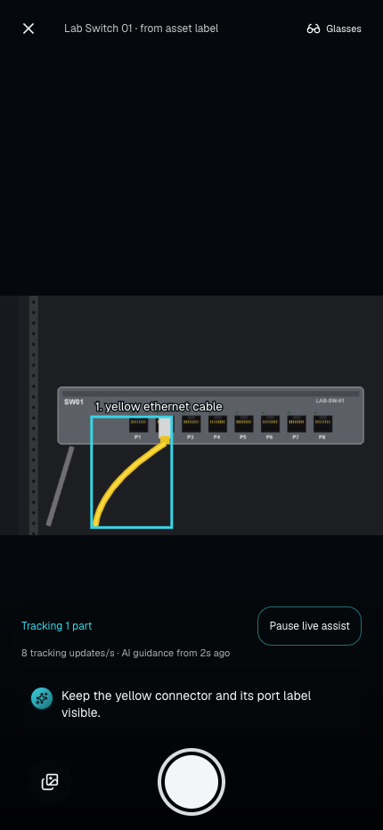
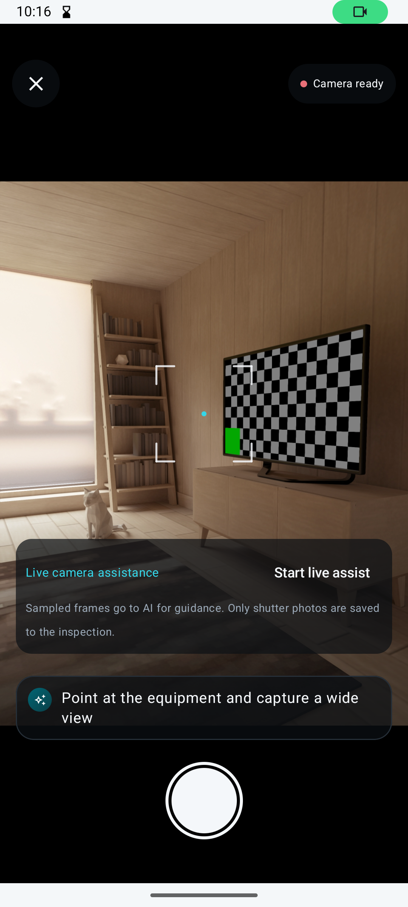
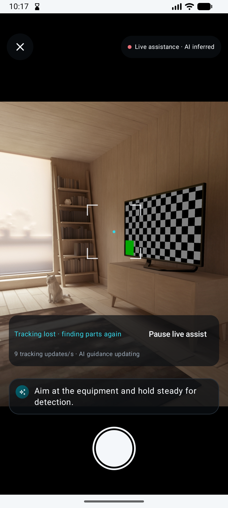

# Live camera evidence — 2026-10-28

- `provider-probe.json`: genuine SAM and Muse responses for a 640×400 synthetic fixture image, before the live-only minimal reasoning profile. Detection took 0.837 seconds; guidance took 10.557 seconds.
- `provider-probe-minimal.json`: genuine responses after the live-only reasoning change. Detection took 1.390 seconds and guidance 3.134 seconds. Includes provider model identifiers and prompt/response digests. Each probe left its isolated inspection with only the creation event.
- `browser-live-tracking.png`: actual browser worker tracking a moving synthetic video source. The smoke test replays the genuine detection from the first probe, moves the image 32 pixels without a fresh detection, then checks disappearance, pause, single-flight requests, no evidence uploads and camera cleanup.
- `android-camera-ready.png`: native Android camera before starting assistance, with the frame-processing disclosure.
- `android-live-assist.png`: native CameraX analyzer active on the emulator's virtual room, showing local update rate. This captures the earlier no-target status wording; it now says “No parts found” until a target has actually been tracked. It is not evidence of real equipment tracking on a physical Android device.

