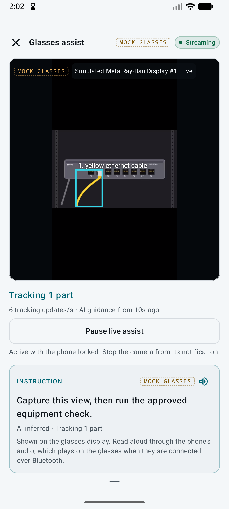

# Live glasses input — 2026-10-28

These checks use **Meta's Mock Device Kit** with a synthetic lab-equipment video, through the same DAT video stream and
MediaCodec decoder used for real glasses. The API uses genuine SAM 3.1 and Muse Spark calls. No physical glasses were available.

- `mock-glasses-live.png`: decoded glasses video, the detected yellow cable, local tracking rate and current guidance.
- `mock-glasses-paused.png`: the same camera after analysis was paused.
- `background-check.json`: bounded smoke results, including foreground-service presence, new inference requests during
  seven seconds with the phone locked, pause/resume behavior and unchanged inspection events. Request counts are cumulative
  within the isolated test server's log, not production traffic.

The first attempt found that starting a decoder after the initial keyframe produced no images. Keeping the decoder primed
while the camera runs fixed late starts and resumes; that case is included in the smoke test. A cooldown-boundary race was
also corrected by waiting from response completion before the next refresh.

To repeat, configure an isolated API storage directory and enable
`Logging__LogLevel__Microsoft.AspNetCore.Hosting.Diagnostics=Information`, redirecting server output to a local log.
Create a fresh lab inspection. On the emulator, open that inspection's Glasses screen, enable the clearly labelled
Mock Device Kit, select the synthetic HEVC lab clip, grant notification permission and start the glasses camera.
Leave **Start live assist** visible, then run:

```sh
python3 scripts/glasses_live_smoke.py --api-log /absolute/path/to/test-api.log --inspection I-TEST
```

This explicitly starts **paid provider requests**, locks/unlocks the emulator, and leaves assistance paused. Use the
test server's actual inspection ID; `--base` defaults to `http://127.0.0.1:5204`. The test does not upload evidence or
change the inspection. Tracking quality on moving real equipment, actual Bluetooth audio playback, device orientation
and battery/thermal behavior require physical hardware checks.


