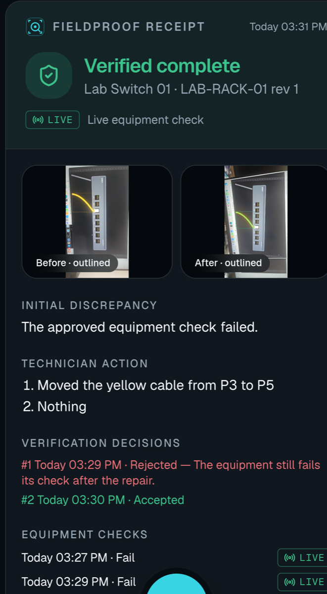

# Live verify on a phone: LIVE_LOCAL_PROBE (loopback) — 2026-10-30

One inspection, `I-6fc49ada4523`, run on a Samsung Galaxy S23 Ultra in Chrome against the API on this Mac in
`Diagnostics:Mode=LiveLocal`. It covers the camera-led verify screen from step B on a real phone camera, a fake fix
refused on a fresh measurement, and a real fix verified live, with genuine Muse and SAM calls.

## What is real and what stands in

| Part | What it was |
|---|---|
| Camera | The phone's rear camera through the web app (`getUserMedia`, shutter in the page). The three photos are recorded with origin `Phone`, 1080×1920. |
| Subject | **A synthetic render of the lab switch shown on the Mac's monitor**, not real equipment: `f02-wrong-port-down.jpg` before (cable in P3), `r01-repaired-clear.jpg` and `r03-repaired-rotated.jpg` after (cable in P5), from `fixtures/telecom-lab/eval/images/`. |
| Muse and SAM | Genuine calls (`MODEL_API_KEY` from `.env`), with the SAM parser run from its pinned requirements. |
| Equipment check | A genuine `LiveLocal` HTTP check of `python3 -m http.server` on the Mac's loopback (`127.0.0.1:8765/health`), standing in for the lab endpoint. The fault is the file missing (404); the repair is the file put back (200). **It does not measure anything in the photos.** The app's "Live equipment check" label means this measurement. |
| Network | The phone reached the API through `adb reverse tcp:5202` over USB, not Wi-Fi or mobile data. |
| Driven by | The person holding the phone took the photos and answered the review, confirmation and verify on the verify screen. The inspection, the first check, the work order and the first claim went through the API; the second claim was made on the phone. |

## Sequence (from `I-6fc49ada4523.events.jsonl`)

1. **Before photo** on the scan page. Muse: switch chassis and yellow cable *Observed*. SAM matched `yellow ethernet cable`, which became the comparison reference.
2. **Live check, 404** → `FaultConfirmed`. Work order and repair claim.
3. **Fake fix.** After photo on the verify screen. SAM comparison **Changed** (cable mask IoU 0, centroid moved 0.73). Three checklist answers Satisfied and confirmation. Verify ran a fresh check (`verify-diag-ea015626a6`) that measured the 404 → **Denied**, `VerificationFailed`.
4. **Real fix.** Health file restored (200). Claimed again on the phone; the claim text typed was "Nothing", and the policy does not read it. New photo **Changed** (IoU 0, shift 0.15). Review and confirmation. Verify's fresh check `verify-diag-324bac97cd` measured 200 → **Verified / `VerifiedCompleteLive`**, policy `fieldproof-policy/1.4`.
5. **Receipt** version 1 (`fieldproof-receipt/1.2`), checked by the server: `isValid: true`, 12 checks, no failures (`receipt-verify.json`).

## Timings (`timings.json`)

Phone and Mac clocks were compared with 15 `adb shell date` samples: the phone was 31.5 ms ahead, ±15.9 ms. Times
from the shutter are corrected for that.

| Step | Time |
|---|---|
| Shutter → photo recorded by the server | 168, 168, 169 ms |
| Shutter → photo comparison verdict on the server (one SAM call + mask comparison) | 2.76 s, 2.07 s |
| Upload request on the server, before photo (no comparison) | 138 ms |
| Muse assessment of the before photo | 7.7 s |
| SAM segmentation of the before photo | 1.3 s, 2.2 s |
| Verify request on the server, including the live HTTP check | 14.8 ms, 6.8 ms |
| Checklist answer, confirmation | 1.5–10 ms each |

**Not measured:** the time from the server's response to the result appearing on the phone, so tap-to-screen
times are not claimed. The verify step itself is effectively instant; the slow parts are the model calls.

## What the run turned up (fixed afterwards, in the same PR)

- After the comparison accepts a photo, the review card was below the photo and off screen; the tester took it for the end of the round until they scrolled. The verify screen now scrolls to the next step's card whenever the step changes.
- The live check labelled an HTTP 404 as `Unreachable`, though the server answered. Probe results now keep the status a server answered with (`httpStatus`), and the decision and screen say "HTTP 404"; `Unreachable` stays as the closed-set value predictions are scored against. The event log in this folder predates the fix, so it still reads `Unreachable`.

## Not in this folder

The raw phone photos and the receipt bundle are left out: the photos also show the Mac's Dock and part of a chat
window at their edges. An earlier inspection in the same run (`I-2718a452517b`) photographed a terminal window by
mistake before the render was put up; it is not part of this evidence.
